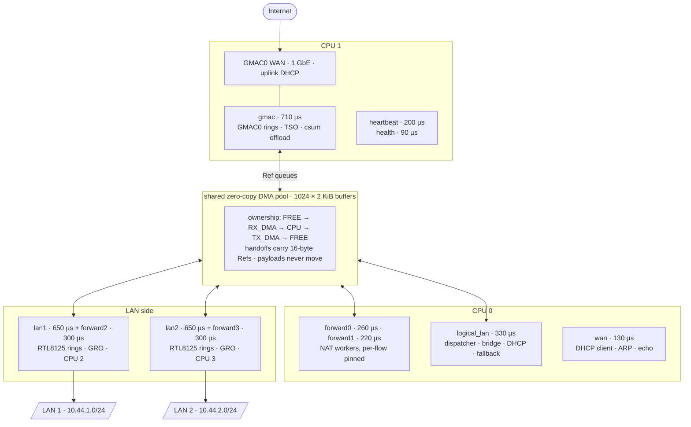
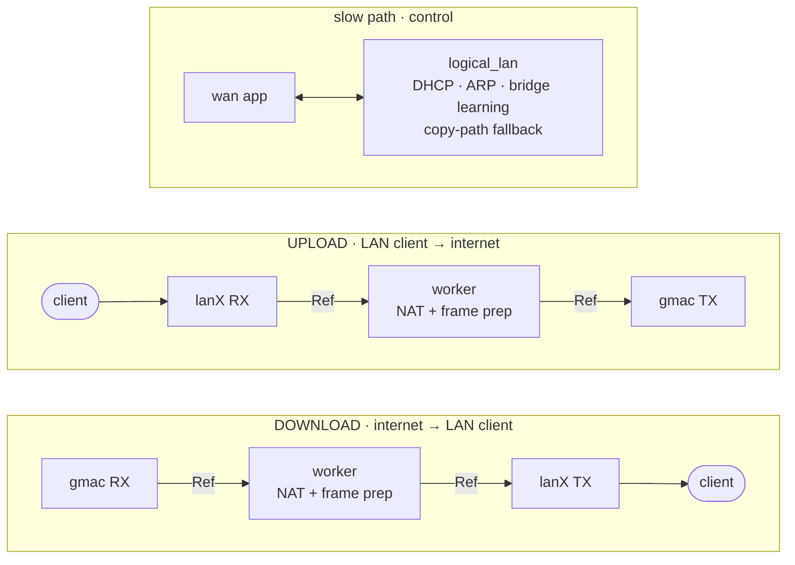

# Native seL4 IPv4 router on NanoPi R5S

A standalone **non-Linux** router: a seL4/Microkit system that does DHCP-configured
native WAN, two independently routed RTL8125 LANs (`10.44.1.0/24`,
`10.44.2.0/24`), native endpoint-preserving NAPT, and fixed stateful forwarding.

Current board-tested build (`h4`, operator-measured, best case): **~440 Mbps
download / ~385 Mbps upload**. Throughput claims are user-observed on real
hardware, not lab-certified. Linux system stays on eMMC as independent recovery and
does not run concurrently with the SD system.

---

## Architecture overview

### The board

NanoPi R5S 4× Cortex-A55, one GMAC0 (WAN, 1 GbE) and two RTL8125 PCIe NICs
(LAN1, LAN2, 2.5 GbE each). WAN addressing comes from upstream DHCP; each LAN is
a fixed /24 with its own DHCP server and NAT gateway.

### System map



### Packet flow



Fast path: the worker finalises the frame (L2, checksum seed, padding, cache
clean) on its own core; the TX side just submits. One TCP flow is pinned to
exactly one worker (pins survive reboots) - new flows land on the least-loaded
worker.

### Notes

- **Zero-copy** - payloads never move; only `Ref`s (buffer id + generation +
  metadata) cross cores, over bounded SPSC queues. Ownership is a strict
  single-owner state machine (`FREE → RX_DMA → CPU → TX_DMA → FREE`);
  generation bumps reject stale references. Workers finalise WAN-bound frames
  (`FLAG_WAN_READY`) so the GMAC submits without per-packet payload work, with a
  per-packet fallback if a cache clean fails.
- **Cache policy** - write-back payload with per-burst maintenance is the
  board-proven setting (`R5S_ZC_CACHE=writeback`). NC payload is **known-broken**
  on this board (34 Mbps upload) and must not be selected.
- **Offloads** - GMAC TSO + IPv4/TCP/UDP checksum insertion, RTL8125 checksum
  insertion, GRO aggregation (250 µs hold), per-flow TX lanes, batched descriptor
  cleaning with one publication barrier per TX batch, adaptive service quanta,
  work-conserving RX/TX loops.

PD budgets (µs per 1 ms) come from the `wan-throughput-isolated` schedule in
`scripts/dual_lan_profile.py`.

---

## Building images

### Prerequisites

Tested builder: Debian 13, x86-64, Python 3.13, Arm GNU 12.2.Rel1, Rust
nightly-2026-08-21. Exact revisions/hashes are in [`sources.lock`](sources.lock);
Python deps in [`requirements.lock`](requirements.lock). All toolchains live in
`tools/` (no system changes). On a fresh host:

```sh
python3 scripts/prepare-tools --fetch     # one-time: populate tools/ (network)
python3 scripts/sources --fetch           # one-time: fetch pinned sources
```

### Build an image (one command)

```sh
. scripts/env
python3 scripts/build-router-performance h4-production out/my-build
```

The image lands at `out/my-build/r5s-rtl8125-lan-repair.img` with
`.manifest.json` and `.sha256` sidecars. Existing output dirs are never
overwritten - pick a fresh directory per build.

### Flavors of the champion tuning (`h4`)

| Profile | What you get |
|---|---|
| `h4-production` | Quiet firmware, release SDK, **no** status endpoint, **no** test generator, **no** fault-code LED patterns - the deployment image |
| `h4-debug` | Debug SDK + firmware logging + the WAN/LAN status JSON endpoint (port 48125, `scripts/read-b51-udp`) + the port-5201 TSO test generator, full LED fault codes - the diagnosis image |

Both carry the same datapath tuning (measure performance on `production`; the
debug SDK and logging cost real cycles).

```sh
python3 scripts/build-router-performance h4-debug out/my-debug
python3 scripts/read-b51-udp <router-ip>        # JSON status from the debug image
```

### Other profiles

`build-router-performance <profile> <dir>` accepts the historical profiles
(`qualification`, `bidirectional`, `wan-throughput`, … - see the `profiles` dict
in `scripts/build-router-performance`). Any recognized option can be overridden
by environment; the build records what it used in `manifest.json`
(`optimization_options`). Important knobs:

| Env | Values | Meaning |
|---|---|---|
| `R5S_LAN_DNS` | `a[,b[,c]]` | DNS servers offered by LAN DHCP (default `77.88.8.8,77.88.8.1`; empty = none) |
| `R5S_ROUTER_SCHEDULE` | see `scripts/dual_lan_profile.py` | PD budgets/placement |
| `R5S_ZC_CACHE` | `writeback` / `nc` | Payload cache policy - **keep `writeback`** |
| `R5S_B51_RX_BATCH` | 8/16/32/64/128 | LAN RX serve batch (64 is the tested winner) |
| `R5S_GMAC_TX_EXTRA_BATCH` | 0/8/16/32/64 | Extra TX burst on budget starvation (8 tested best) |
| `R5S_FIRMWARE_LOG`, `R5S_LED_FAULTS`, `R5S_LAN_B51_UDP`, `R5S_TSO_TEST` | 0/1 | The flavor switches (see above) |

### Custom LAN DNS

The DNS servers offered to LAN clients (both LANs get the same list) are baked
into the image at build time. The default is `77.88.8.8, 77.88.8.1`.

```sh
# custom servers: up to three comma-separated unicast IPv4 addresses
R5S_LAN_DNS=1.1.1.1,1.0.0.1 python3 scripts/build-router-performance h4-production out/my-build

# offer no DNS option at all (clients fall back to their own configuration)
R5S_LAN_DNS= python3 scripts/build-router-performance h4-production out/my-build
```

The variable works with every profile and flavor. Each image records what it
carries in the `lan_dns` field of its `manifest.json` sidecar:

```sh
python3 -c "import json,ipaddress as i;m=json.load(open('out/my-build/r5s-rtl8125-lan-repair.manifest.json'));print([str(i.IPv4Address(x)) for x in m['lan_dns']])"
```

### Verify and reproduce

```sh
python3 scripts/image.py verify out/my-build/r5s-rtl8125-lan-repair.img
```

Deliverables are expected to be reproducible: build twice into two directories
and compare SHA256 (the manifest and image must be byte-equal). Every image under
`out/` in this repo ships its twin in a `*-repro/` directory or is documented as
a single-build measurement artifact.

---

## Flashing and testing

**No build command writes a device.** `scripts/flash-sd` defaults to dry run and
requires explicit model/serial/capacity expectations before `--execute` - read
[docs/sd-writing.md](docs/sd-writing.md), [docs/boot-selection.md](docs/boot-selection.md)
and [docs/recovery.md](docs/recovery.md) first (for FriendlyElec's hidden R5S
OverlayFS root see [docs/r5s-overlay-writer.md](docs/r5s-overlay-writer.md)):

```sh
python scripts/flash-sd --device /dev/EXPLICIT_WHOLE_DEVICE \
  --image out/my-build/r5s-rtl8125-lan-repair.img --profile usb \
  --expect-model 'EXACT MODEL' --expect-serial 'EXACT SERIAL' \
  --expect-bytes EXACT_CAPACITY
```

Testing is manual: a wired iperf3 server upstream of the router and a LAN client;
run upload, reverse download and bidirectional for 30 s at 1 and 8 streams,
interleaving images when comparing. Ready-made procedures live in the
`out/*/RUN-SHEET.md` files (e.g. [out/r5s-tput/RUN-SHEET.md](out/r5s-tput/RUN-SHEET.md)).
The LAN client must receive DNS `77.88.8.8`/`77.88.8.1` (or your `R5S_LAN_DNS`)
via DHCP.

### LED meaning (SYS)

Rust firmware: three short flashes then a pause on healthy startup. Supervisor
status: slow blink = no link, brief flash every 4 s = ready, a richer pattern =
I/O verified. Fault state shows a fast blink with coded long/short sequences
(`production` builds suppress the fault patterns and show the healthy pattern
instead; fault state is still recorded in the status words). U-Boot: one long
flash; solid SYS = payload refusal. A Linux heartbeat is not success.

---

## Repository map

| Path | Contents |
|---|---|
| `pds/` | Microkit protection domains (drivers, workers, dispatcher, WAN app, supervisor) |
| `drivers/` | GMAC0 C DMA engine + RTL8125 Rust driver/rings |
| `router-core/` | NAT, DHCP, ARP, bridge, checksums (no_std, host-tested) |
| `scripts/` | Build profiles, layout generator, image assembly/verification, diagnostics readers |
| `docs/` | Architecture, DMA strategy, hardware audits, boot/recovery, provenance |
| `tests/` | Host-side test pins for the C DMA suite (read-only reference) |
| `out/` | Built images + manifests + run sheets (never overwritten) |

Networking, watchdogs, virtualization and firewall functionality are out of
scope: see [docs/security-scope.md](docs/security-scope.md) and
[docs/provenance.md](docs/provenance.md).
